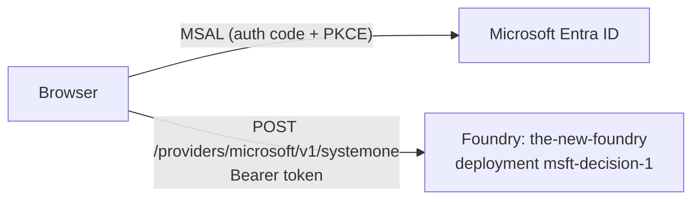

# Decide Something

A React single-page app for **Microsoft-Decision-1**, using its "System 1" API on Microsoft Foundry. You enter a question, a list of choices and some state text (for example, a conversation transcript). The model picks a choice and returns its confidence and the probability of each option.



The browser signs the user in with MSAL. It requests a token for `https://cognitiveservices.azure.com/.default` and calls Foundry directly. There is no backend. Each signed-in user needs data-plane access to the Foundry account, for example the *Cognitive Services User* role.

## Quick Start

```sh
azd config set alpha.deployment.stacks on   # required, see "Infrastructure" below
                                             # (or per shell: export AZD_ALPHA_ENABLE_DEPLOYMENT_STACKS=true)
azd up                                       # deploys the model + app registration, writes frontend/.env.local
cd frontend
pnpm install
pnpm dev                                     # http://localhost:5173
```

## Prerequisites

- [Azure CLI](https://learn.microsoft.com/cli/azure/install-azure-cli)
- [Azure Developer CLI (azd)](https://learn.microsoft.com/azure/developer/azure-developer-cli/install-azd), with the `deployment.stacks` alpha feature enabled
- [Ruby](https://www.ruby-lang.org/en/documentation/installation/) (for hook scripts)
- [Node.js](https://nodejs.org/en/download) and [pnpm](https://pnpm.io/installation)
- Permission to create model deployments on the `the-new-foundry` account and to create Entra app registrations

The `preprovision` hook checks all of these.

## Infrastructure

Everything is defined in Bicep. The Foundry account `the-new-foundry` (resource group `the-new-foundry`) is shared and already exists. It is only ever referenced, never declared.

| What | Where | Deployed by |
| --- | --- | --- |
| Model deployment `msft-decision-1` (Microsoft-Decision-1 v1, `GlobalStandard`) | [infra/main.bicep](infra/main.bicep), [infra/modules/decision-deployment.bicep](infra/modules/decision-deployment.bicep) | azd, as a deployment stack |
| Entra app registration (SPA redirect URIs, Cognitive Services `user_impersonation`) | [infra/identity/app-registration.bicep](infra/identity/app-registration.bicep) | the `postprovision` hook (`az deployment sub create`) |

Why the split:

- **Deployment stacks keep `azd down` safe.** Without stacks, `azd down` deletes *every resource group* that a deployment touched, and that would include the shared `the-new-foundry` group. With stacks (`actionOnUnmanage: resources delete, resourceGroups detach` in [azure.yaml](azure.yaml)), `azd down` deletes only the `msft-decision-1` deployment.
- **Deployment stacks don't support the Microsoft Graph Bicep extension.** azd's stacks flag applies to every Bicep deployment it makes, so the app registration is deployed as a regular subscription deployment from the hook. The `postdown` hook deletes it again.

The deployment name avoids the word "Microsoft" because azd rejects deployment names that contain reserved words.

### Settings

Set these with `azd env set <NAME> <value>` before `azd provision`:

| Name | Default | Purpose |
| --- | --- | --- |
| `SPA_REDIRECT_URIS` | `http://localhost:5173` | Comma-separated SPA redirect URIs. Add your production origin here, e.g. `http://localhost:5173,https://decide.example.com` |
| `DECISION_CAPACITY` | `10` | Deployment capacity (1 unit = 1 request per minute) |

### Outputs

The postprovision hook writes these to the azd environment and also to `frontend/.env.local`:

| azd env | Vite env |
| --- | --- |
| `ENTRA_CLIENT_ID` | `VITE_ENTRA_CLIENT_ID` |
| `AZURE_TENANT_ID` | `VITE_ENTRA_TENANT_ID` |
| `FOUNDRY_ENDPOINT` | `VITE_FOUNDRY_ENDPOINT` |
| `DECISION_DEPLOYMENT_NAME` | `VITE_DECISION_DEPLOYMENT` |

## Build for Deployment

```sh
cd frontend
pnpm build      # minified, ready-to-serve static files in frontend/dist/
pnpm run publish
```

Vite inlines the `VITE_*` values at build time, so build after `azd provision`. Serve `dist/` from any static host whose origin is listed in `SPA_REDIRECT_URIS`. You can check the build locally with `pnpm preview`, which serves it on the same `http://localhost:5173` origin.

## Project Structure Highlights

```sh
poc-decide-something/
├── azure.yaml                         # azd project definition (infra, deployment stack settings, hooks)
├── infra/
│   ├── main.bicep                     # azd entry point: model deployment (deployment stack)
│   ├── main.bicepparam
│   ├── bicepconfig.json               # Microsoft Graph Bicep extension
│   ├── modules/
│   │   └── decision-deployment.bicep  # accounts/deployments on the existing Foundry account
│   └── identity/
│       ├── app-registration.bicep     # Entra SPA app registration (Graph)
│       └── app-registration.bicepparam
├── frontend/                          # React + MSAL SPA (see frontend/README.md)
└── scripts/                           # Ruby gem for azd hook lifecycle
    ├── exe/                           # Lifecycle hooks for azd
    └── spec/integration               # Integration tests for deployed services
```

## Development

Hook scripts live under `scripts/` as a Ruby gem. See [scripts/README.md](scripts/README.md) for how to add new hook logic.

- `preprovision`: checks tools, logins and the `deployment.stacks` alpha flag.
- `postprovision`: deploys the app registration, then writes `frontend/.env.local`.
- `predown`: stops `azd down` if deployment stacks are off. Without stacks, azd would delete the shared resource group.
- `postdown`: deletes the app registration.

```sh
cd scripts && bundle exec rspec          # hook unit tests
cd frontend && pnpm test && pnpm lint    # frontend unit tests + lint
cd frontend && pnpm run integration-test # frontend integration tests
```

## Running Integration Tests

Live integration tests check behaviour against real, deployed resources (run `azd up` first). To run the integration suite:

```sh
cd scripts/ && bundle exec rake integration
```

[scripts/spec/integration/decision_app_spec.rb](scripts/spec/integration/decision_app_spec.rb) builds the frontend, serves `dist/` with `vite preview`, and checks the page, the bundle's azd-provided config, the app registration and Foundry CORS. It then calls the decision API on the deployed model with an `az account get-access-token` token, used in place of the browser's MSAL sign-in.
