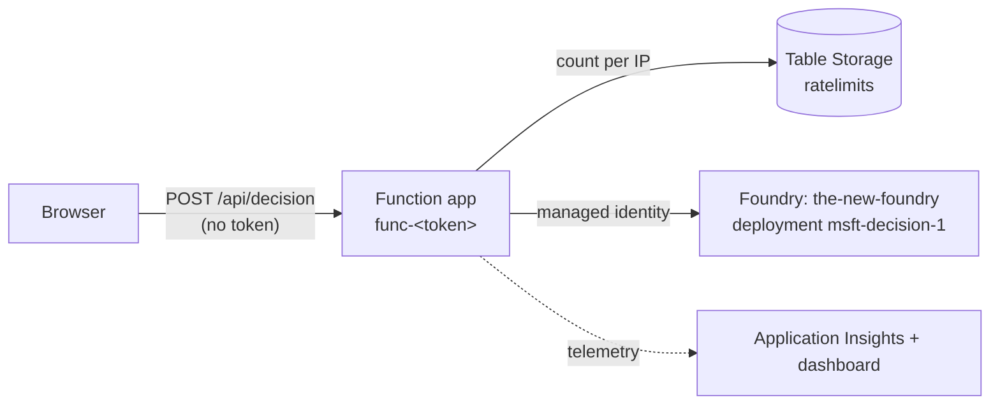

# Microsoft-Decision-1

A React single-page app for **Microsoft-Decision-1**, using its "System 1" API on Microsoft Foundry. You enter a question, a list of choices and some state text (for example, a conversation transcript). The model picks a choice and returns its confidence and the probability of each option.

There are two deployment modes, currently I've set it to anonymous access mode.


## Requirements

- [Azure CLI](https://learn.microsoft.com/cli/azure/install-azure-cli)
- [Azure Developer CLI (azd)](https://learn.microsoft.com/azure/developer/azure-developer-cli/install-azd), with the `deployment.stacks` alpha feature enabled
- [Ruby](https://www.ruby-lang.org/en/documentation/installation/) (for hook scripts)
- [Node.js](https://nodejs.org/en/download) and [pnpm](https://pnpm.io/installation)
- A Foundry Project ready for models to be deployed to

## Quick Start

### Configure
This repository assumes you have an existing Foundry account you plan to deploy into.  Configure this via the azd tool.

```sh
azd config set alpha.deployment.stacks on  

azd env set FOUNDRY_RESOURCE_GROUP_NAME existing-foundry-rg
azd env set FRONTEND_URL "https://gh-handle.github.com/microsoft-decision-1-example/"
azd env set ADDITIONAL_SPA_REDIRECT "http://localhost:5173"
azd env set DECISION_CAPACITY "10" # how many API requests per minute of model throughput

# These are the demo settings
# azd env set ANONYMOUS_MODE "true"
# azd env set ANONYMOUS_CORS_ORIGINS "https://ghworkacc.github.io,http://localhost:5173"
# azd env set ANONYMOUS_RATE_LIMIT_PER_MINUTE "5"
```

Then run the following to deploy the model and the app registration, and start the frontend:

```sh
azd up         # deploys the model + app registration, writes frontend/.env.local

cd frontend
pnpm install
pnpm dev       # http://localhost:5173
```


## Project Structure Highlights

```sh
poc-decide-something/
├── azure.yaml                         # azd project definition (infra, deployment stack settings, hooks)
│
├── infra/
│   ├── main.bicep                     # azd entry point: model deployment + anonymous proxy (deployment stack)
│   │
│   ├── modules/
│   │   ├── decision-deployment.bicep  # accounts/deployments on the existing Foundry account
│   │   └── foundry-role-assignment.bicep # Function identity -> Cognitive Services User
│   │
│   └── identity/
│       ├── app-registration.bicep     # Entra SPA app registration (Graph)
│       └── app-registration.bicepparam
│
├── api/                               # Trivial rate-limited anonymous proxy (Azure Function)
│
├── frontend/                          # React + MSAL SPA UI
│
└── scripts/                           # Ruby gem for azd hook lifecycle
    ├── exe/                           # Lifecycle hooks for azd
    └── spec/integration               # Integration tests for deployed services
```

## Infrastructure

Everything is defined in Bicep. The Foundry account `the-new-foundry` (resource group `the-new-foundry`) is shared and already exists. It is only ever referenced, never declared.

| What | Where | Deployed by |
| ---  | ---   | ---         |
| Model deployment `msft-decision-1` (Microsoft-Decision-1 v1, `GlobalStandard`) | [infra/main.bicep](infra/main.bicep), [infra/modules/decision-deployment.bicep](infra/modules/decision-deployment.bicep) | azd, as a deployment stack |
| Entra app registration (SPA redirect URIs, Cognitive Services `user_impersonation`) | [infra/identity/app-registration.bicep](infra/identity/app-registration.bicep) | the `postprovision` hook (`az deployment sub create`) |
| Resource group `rg-poc-decide-something-<env>` with the anonymous proxy: Function app (Flex Consumption, Node 22), storage, Application Insights, Log Analytics, dashboard | [infra/modules/anonymous-api.bicep](infra/modules/anonymous-api.bicep), [infra/modules/dashboard.bicep](infra/modules/dashboard.bicep) | azd, as a deployment stack |
| *Cognitive Services User* on the Foundry account for the Function's managed identity | [infra/modules/foundry-role-assignment.bicep](infra/modules/foundry-role-assignment.bicep) | azd, as a deployment stack |

### Outputs

The postprovision hook will write various azd environment outputs to `frontend/.env.local` allowing the frontend to to run with the correct connection strings to reach the backend services.

## Anonymous mode



You'll find code in this repository related to enabling anonymous access to the demo.  This isn't recommended, and I'll likely need to remove it as spiders notice the demo =/

To turn it on anonymous mode (for demoing purposes), run:

```sh
azd env set ANONYMOUS_MODE true
azd up                       # provisions the proxy, deploys api/, rewrites frontend/.env.local
cd frontend && pnpm run publish
```

To turn it off, run `azd env set ANONYMOUS_MODE false` and `azd provision`. The proxy then refuses all requests, and the next build signs users in again. After code-only changes to `api/`, `azd deploy api` is enough.

## Build for Deployment

```sh
cd frontend && pnpm run publish
```

Vite consumes envs from `azd provision` hooks.

## Development

Hook scripts live under `scripts/` as a Ruby gem. See [scripts/README.md](scripts/README.md) for how to add new hook logic.

- `preprovision`: checks tools, logins and the `deployment.stacks` alpha flag.
- `preprovision`: also initializes missing deployment settings in the active azd environment; existing `azd env set` values are preserved.
- `postprovision`: deploys the app registration, then writes `frontend/.env.local`.
- `predown`: stops `azd down` if deployment stacks are off. Without stacks, azd would delete the shared resource group.
- `postdown`: deletes the app registration.

```sh
cd scripts && bundle exec rspec          # hook unit tests
cd frontend && pnpm test && pnpm lint    # frontend unit tests + lint
cd api && npm install && npm test && npm run lint # proxy unit tests + lint
cd frontend && pnpm run integration-test # frontend integration tests
```

## Running Integration Tests

Live integration tests check behaviour against real, deployed resources (run `azd up` first). To run the integration suite:

```sh
cd scripts/ && bundle exec rake integration
```

## Frontend

See [frontend/README.md](frontend/README.md) for details on the React SPA.

## API

A simple Function app proxy that forwards requests to the Foundry model when running in anonymous mode.  Always deploys, but unused when `ANONYMOUS_MODE=false`.
